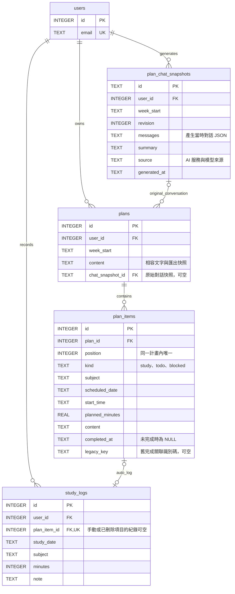
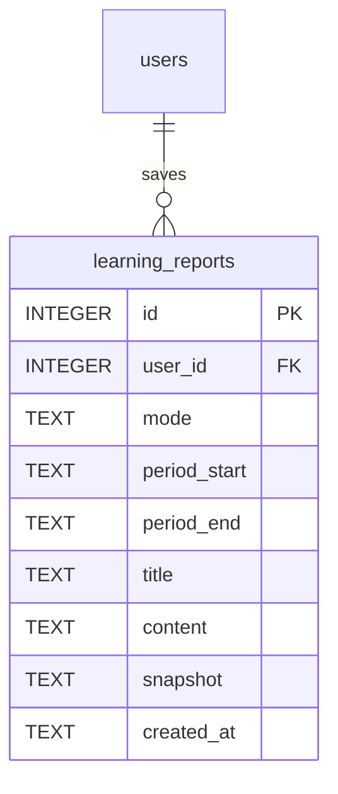

# 計畫項目與學習紀錄 ERD

本文件描述已實作的關聯；科目獨立資料表與逐筆 AI 訊息表仍屬於後續設計，這次沒有搬移。

- `plan_items.id` 為固定編號，排序、時段與內容調整時可保留識別。
- `study_logs.plan_item_id` 是可空外鍵，非空時有唯一索引；一個項目最多一筆自動學習紀錄。
- 取消完成會撤銷該項目的自動紀錄；刪除計畫或項目則保留歷史學習紀錄，外鍵設為 NULL。
- 已完成項目的內容修改不會改寫過去學習紀錄。學習紀錄仍可單獨修改。
- 已儲存計畫由 `GET /plans/{plan_id}/items` 讀取項目，完成使用 `PATCH /plan-items/{item_id}/completion`。
- 舊按位置勾選 API 保留相容；舊 `plan_completion_logs` 表保留供搬移與舊資料稽核，新功能不再寫入該表。
- 原始文字、分析與時間限制仍保留在 `plans.content`，用於相容與匯出；計畫新增或編輯時，於同一交易內同步獨立項目，完成狀態則由 `plan_items.completed_at` 保存。

## 舊資料搬移

首次啟動時，若已有使用者，會先以 SQLite backup 建立 `資料庫所在資料夾/backups/learnpilot-before-plan-items-日期時間.db` 並檢查備份。之後於同一交易內建立新表、加上外鍵與唯一索引、搬移現有排程，並將舊自動紀錄連到對應項目。原有帳號、密碼雜湊、計畫文字及紀錄不會重新建立或清除；手動紀錄維持 NULL 關聯。找不到現存項目的歷史紀錄不會被強行配對。

搬移成功記錄於 `schema_migrations`，重複啟動不會重複搬移。格式不符或關聯歸屬不一致時會回復本次變更並停止啟動，錯誤中會提供備份位置；請保留原資料排查，不要刪除資料庫。舊資料只有完成布林值，無法還原真實完成時刻，因此這類項目的 `completed_at` 以搬移時間補齊。沒有原本自動紀錄的已完成項目不會在搬移中憑空產生學習時數。

更新需同步套用前後端檔案並停止所有舊後端，再啟動新版。若需要整份回復，先停止全部服務，以搬移前備份搭配前一版程式還原；請勿讓新舊後端同時寫入同一資料庫。

## 計畫原始對話快照

AI 產生草稿成功時，伺服器將當時的對話複製到 `plan_chat_snapshots`；儲存計畫時以 `plans.chat_snapshot_id` 關聯。此關聯建立後不可替換或清空，編輯計畫或勾選完成仍保留。每次產生草稿有獨立快照，後續對話或清除 `planning_chats` 不會改變已儲存的來源。前端匯入新 AI 草稿會建立新計畫，避免將舊計畫來源改成新對話。

快照可被同一份草稿另存的多份計畫引用；手動與舊版計畫可無快照。所有新增關聯與讀取都檢查使用者歸屬，不提供修改快照的 API。既有資料只增加可空欄位，無法回溯確定原始來源的舊計畫不會自動配對現有聊天。

## 已儲存學習報告

`learning_reports` 是帳號專屬的報告快照。snapshot 以 JSON 保存當時學習紀錄與最新科目目標；來源資料修改或刪除不會影響已保存報告。報告與來源紀錄、目標沒有外鍵依賴。

## 固定計畫編號

`plans.plan_number` 為 TEXT、唯一索引（UK），由系統配置如 `LP-000001`；原 id 主鍵與既有外鍵維持原樣。`plan_number_sequence.number` 為 INTEGER PRIMARY KEY AUTOINCREMENT，用來配置不重用的序號，沒有對外業務關聯。編輯計畫不接受修改編號。序號以資料庫為範圍共用。
